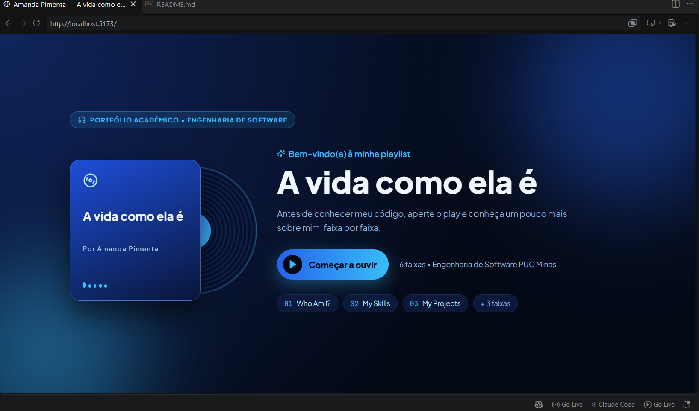
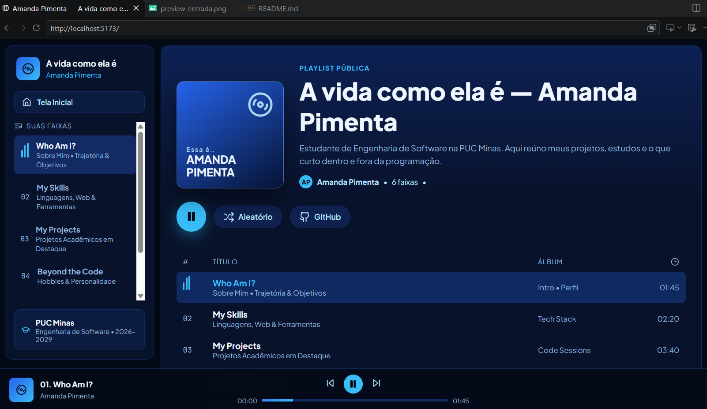

# 🎧 A vida como ela é — Amanda Pimenta

> [!NOTE]
> Portfólio pessoal e profissional inspirado na interface do **Spotify**, desenvolvido em **tons de azul** para apresentar minha trajetória acadêmica, habilidades, projetos e formas de contato no formato de uma playlist interativa.

<table>
  <tr>
    <td width="800px">
      <div align="justify">
        Este projeto apresenta o meu portfólio pessoal <b>A vida como ela é — Amanda Pimenta</b>, desenvolvido durante a graduação em <b>Engenharia de Software na PUC Minas</b>. A proposta transforma um portfólio tradicional em uma experiência inspirada em plataformas de streaming: ao entrar no site, o visitante passa por uma tela inicial imersiva e acessa uma playlist onde cada faixa revela uma parte da minha história — quem eu sou, minhas habilidades, meus projetos acadêmicos, meus hobbies, minha formação e meus canais de contato.
      </div>
    </td>
    <td>
      <div align="center">
        
      </div>
    </td>
  </tr>
</table>

---

## 🚧 Status do Projeto


---

## 📚 Índice
- [Links Úteis](#-links-úteis)
- [Sobre o Projeto](#-sobre-o-projeto)
- [Funcionalidades Principais](#-funcionalidades-principais)
- [Tecnologias Utilizadas](#-tecnologias-utilizadas)
- [Arquitetura](#-arquitetura)
- [Instalação e Execução](#-instalação-e-execução)
  - [Pré-requisitos](#pré-requisitos)
  - [Variáveis de Ambiente](#-variáveis-de-ambiente)
  - [Instalação de Dependências](#-instalação-de-dependências)
  - [Como Executar a Aplicação](#-como-executar-a-aplicação)
- [Deploy](#-deploy)
- [Estrutura de Pastas](#-estrutura-de-pastas)
- [Demonstração](#-demonstração)
- [Documentações utilizadas](#-documentações-utilizadas)
- [Autores](#-autores)
- [Contribuição](#-contribuição)
- [Agradecimentos](#-agradecimentos)
- [Licença](#-licença)

---

## 🔗 Links Úteis
* 🌐 **Demo Online:** [Acesse o Portfólio na Vercel](https://portfolio-tp-1-woad.vercel.app/)
  > 💻 **Descrição:** Link para a aplicação publicada em ambiente de produção na Vercel.
* 💻 **Repositório:** [Acesse no GitHub](https://github.com/amandapfig/portfolio_TP1.git)
  > 📂 **Descrição:** Código-fonte completo do projeto versionado no GitHub.
* 🎨 **Protótipo (Figma):** [Acesse os Wireframes](https://www.figma.com/make/KETOrbBlganmW9dziwLTNy/Portf%C3%B3lio-Amanda-Pimenta?t=X3oFeSuUbYKslO8F-20&fullscreen=1)
  > ✏️ **Descrição:** Protótipos de média fidelidade utilizados no planejamento visual das telas.

---

## 📝 Sobre o Projeto

O objetivo deste projeto é apresentar minha trajetória acadêmica, habilidades técnicas e personalidade de forma moderna, criativa e acessível.

* **Motivação:** Criar um portfólio que fugisse do formato estático de currículo e refletisse meu gosto por música, tecnologia.
* **Contexto:** Projeto desenvolvido como estudante de **Bacharelado em Engenharia de Software na PUC Minas (2026–2029)**, buscando minha primeira oportunidade de estágio na área de desenvolvimento de software e desenvolvimento web.
* **Organização por Faixas:**
  * **Faixa 01 — Who Am I?:** Apresentação pessoal, foto, perfil e objetivos profissionais.
  * **Faixa 02 — My Skills:** Linguagens de programação, desenvolvimento web e ferramentas.
  * **Faixa 03 — My Projects:** Projetos acadêmicos (**PEDALAKI**, **Relógio Digital**, **Jogo da Forca**, **TurboEscape** e **PimentaSabor**).
  * **Faixa 04 — Beyond the Code:** Hobbies, esportes (handebol e basquete), música e interesses pessoais.
  * **Faixa 05 — My Journey:** Formação acadêmica na PUC Minas e idiomas (Português nativo e Inglês avançado).
  * **Faixa 06 — Let’s Connect:** Links diretos de contato e formulário funcional.

---

## ✨ Funcionalidades Principais

- 🎧 **Tela de Entrada Imersiva:** Abertura inspirada em plataformas de streaming convidando o visitante a iniciar a playlist.
- 🎵 **Navegação Estilo Playlist:** Menu lateral, tabela de faixas clicável, botão aleatório e barra de reprodução inferior sincronizada com a seção ativa.
- 👤 **Apresentação Pessoal:** Seção *Sobre Mim* com foto e destaque para trajetória e objetivo de estágio.
- 💻 **Portfólio de Projetos:** Cards individuais com descrição, tecnologias utilizadas e link direto para o GitHub.
- 🏀 **Personalidade Além do Código:** Seção dedicada a hobbies, esportes e interesses pessoais.
- ✉️ **Contato Direto e Formulário:** Links clicáveis (E-mail, WhatsApp, GitHub e LinkedIn) e formulário com validação e envio via **EmailJS**.
- 📱 **Design Responsivo:** Interface adaptada para computadores, tablets e celulares.

---

## 🛠 Tecnologias Utilizadas

### 💻 Front-end

* **Biblioteca:** React (`19.x`)
* **Build Tool:** Vite (`6.x`)
* **Linguagem:** JavaScript (ES6+) / HTML5
* **Estilização:** CSS3 puro com variáveis de tema em tons de azul e layout responsivo (Grid/Flexbox)
* **Ícones:** `lucide-react`
* **Serviço de E-mail:** `@emailjs/browser`

### ⚙️ Ferramentas & Deploy

* **Versionamento:** Git e GitHub
* **Prototipação:** Figma
* **Hospedagem em Nuvem:** Vercel

---

## 🏗 Arquitetura

A aplicação segue uma arquitetura **Front-end modularizada por componentes** (*Single Page Application* — SPA):

- **Camada de Dados (`src/data/playlistData.js`):** Centraliza as faixas, textos de apresentação, habilidades, projetos, hobbies, formação acadêmica e contatos.
- **Camada de Interface (`src/components/`):**
  - Componentes estruturais (`EntryExperience`, `Sidebar`, `PlaylistHeader`, `PlayerBar` e `TrackContent`).
  - Subpasta `src/components/secoes/` separando cada faixa em seu próprio módulo (`Sobre`, `Habilidades`, `Projetos`, `Hobbies`, `Formacao` e `Contato`).
- **Integração de Contato:** Envio de mensagens realizado diretamente no cliente via **EmailJS**, protegido por variáveis de ambiente (`VITE_EMAILJS_*`).

---

## 🔧 Instalação e Execução

### Pré-requisitos
Certifique-se de ter instalado em seu computador:

* **Node.js:** Versão **18.x** ou superior
* **Gerenciador de Pacotes:** npm (instalado junto com o Node.js)
* **Git:** Para clonar o repositório

---

### 🔑 Variáveis de Ambiente

Caso queira ativar o envio automático de e-mails no formulário de contato, crie um arquivo **`.env.local`** na raiz do projeto utilizando o prefixo `VITE_`:

| Variável | Descrição | Exemplo |
| :--- | :--- | :--- |
| `VITE_EMAILJS_SERVICE_ID` | ID do serviço configurado no EmailJS. | `service_xxxxxxx` |
| `VITE_EMAILJS_TEMPLATE_ID` | ID do template de e-mail criado no EmailJS. | `template_xxxxxxx` |
| `VITE_EMAILJS_PUBLIC_KEY` | Chave pública da sua conta EmailJS. | `sua_public_key_aqui` |

Exemplo do arquivo `.env.local`:

```env
VITE_EMAILJS_SERVICE_ID=seu_service_id_aqui
VITE_EMAILJS_TEMPLATE_ID=seu_template_id_aqui
VITE_EMAILJS_PUBLIC_KEY=sua_public_key_aqui
```

> **Obs.:** Para o deploy em produção na **Vercel**, cadastre essas mesmas 3 variáveis em **Project Settings > Environment Variables**.

---

### 📦 Instalação de Dependências

1. **Clone o repositório:**

```bash
git clone https://github.com/amandapfig/SEU-REPOSITORIO.git
cd SEU-REPOSITORIO
```

2. **Instale as dependências do projeto:**

```bash
npm install
```

---

### ⚡ Como Executar a Aplicação

Execute o servidor de desenvolvimento do Vite:

```bash
npm run dev
```

🎨 *A aplicação estará disponível localmente em **http://localhost:5173**.*

---

## 🚀 Deploy

O deploy da aplicação é feito gratuitamente pela **Vercel** conectado ao repositório do GitHub:

1. **Build do Projeto (opcional para testar localmente):**
```bash
npm run build
```
*(Gera a pasta `/dist` com os arquivos estáticos prontos para produção).*

2. **Configuração na Vercel:**
   * Importe o repositório com o preset **Vite**.
   * Configure as variáveis de ambiente `VITE_EMAILJS_*` no painel do projeto.
   * Comando de build: `npm run build` | Diretório de saída: `dist`.

---

## 📂 Estrutura de Pastas

amanda-pimenta-portfolio/
├── .env.example                 # Modelo das variáveis de ambiente (sem chaves sensíveis)
├── .env.local                   # Variáveis locais do EmailJS (não versionado)
├── .gitignore                   # Arquivos e pastas ignorados pelo Git
├── index.html                   # Documento HTML principal
├── package-lock.json            # Controle de versões exatas das dependências
├── package.json                 # Dependências e scripts do projeto
├── vite.config.js               # Configuração do Vite
├── README.md                    # Documentação principal do projeto
│
├── /public
│   └── /images
│       ├── amanda.jpg           # Foto pessoal exibida na seção Sobre Mim
│       ├── corrida.png          # Preview do projeto Jogo de Corrida
│       ├── forca.png            # Preview do projeto Jogo da Forca
│       ├── pedalaki.png         # Preview do projeto Pedalaki
│       ├── preview-entrada.png  # Print da tela inicial (Demonstração)
│       ├── preview-playlist.png # Print da tela principal (Demonstração)
│       ├── relogio.png          # Preview do projeto Relógio Digital
│       └── restaurante.png      # Preview do projeto PimentaSabor
│
└── /src
    ├── App.css                  # Estilização global em tons de azul e responsividade
    ├── App.jsx                  # Orquestração principal da entrada, playlist e player
    ├── main.jsx                 # Ponto de entrada do React
    ├── /data
    │   └── playlistData.js      # Dados da playlist, projetos, habilidades e contatos
    └── /components
        ├── EntryExperience.jsx  # Tela inicial inspirada na entrada do streaming
        ├── Sidebar.jsx          # Menu lateral com navegação rápida das faixas
        ├── PlaylistHeader.jsx   # Capa da playlist, ações e tabela de faixas
        ├── PlayerBar.jsx        # Barra de reprodução fixa inferior
        ├── TrackContent.jsx     # Roteador interno que exibe a faixa selecionada
        └── /secoes              # Componentes individuais de cada faixa
            ├── Sobre.jsx
            ├── Habilidades.jsx
            ├── Projetos.jsx
            ├── Hobbies.jsx
            ├── Formacao.jsx
            └── Contato.jsx

---

## 🎥 Demonstração

### 🌐 Aplicação Web

| Tela de Entrada | Página Principal (Playlist) |
| :---: | :---: |
|  |  |

---

## 🔗 Documentações utilizadas

* 📖 **Biblioteca Front-end:** [Documentação Oficial do **React**](https://react.dev/)
* 📖 **Build Tool:** [Documentação do **Vite**](https://vitejs.dev/)
* 📖 **Ícones:** [Documentação do **Lucide React**](https://lucide.dev/)
* 📖 **Envio de E-mails:** [Documentação do **EmailJS**](https://www.emailjs.com/docs/)
* 📖 **Hospedagem:** [Documentação da **Vercel**](https://vercel.com/docs)

---

## 👥 Autores

| 👤 Nome | 🖼️ Foto | :octocat: GitHub | 💼 LinkedIn | 📤 Gmail |
|---------|----------|-----------------|-------------|-----------|
| Amanda Pimenta | <div align="center"></div> | <div align="center"><a href="https://github.com/amandapfig"></a></div> | <div align="center"><a href="https://www.linkedin.com/in/amandapimentaf"></a></div> | <div align="center"><a href="mailto:amandapfigueiredo55@gmail.com"></a></div> |

---

## 🤝 Contribuição

Sugestões e melhorias são sempre bem-vindas!

1. Faça um `fork` do projeto.
2. Crie uma br